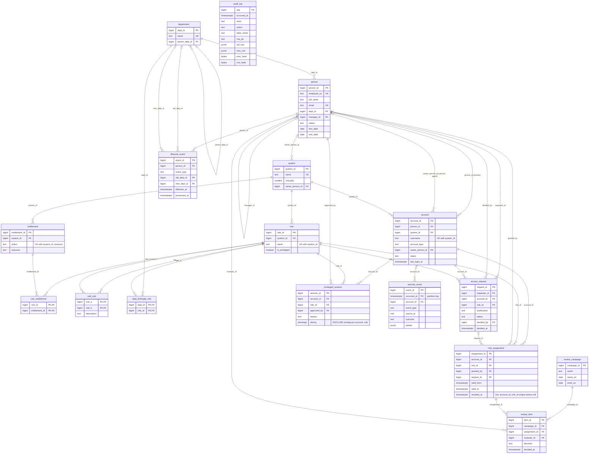

# IGA schema: entity-relationship diagram

All 16 tables of the spec (section 3.1) plus the helper table `dept_birthright_role`. Crow's-foot notation: `||` exactly one, `o|` zero or one, `o{` zero or many, `|{` one or many. Each relationship line is labelled with the foreign-key column.

## Reading the diagram against spec 3.2

| Spec relationship | In the diagram |
|---|---|
| Department 1:N Person; Person 1:N Person (manager); Department 1:N Department (parent) | `department -> person`, `person -> person` (manager_id), `department -> department` (parent_dept_id) |
| Person 1:N Account; System 1:N Account, Role, Entitlement | `person -> account` (person_id for human accounts, owner_person_id for service and agent accounts); `system -> account / role / entitlement` |
| Role M:N Entitlement | via `role_entitlement` (composite primary key resolves the many-to-many) |
| Account M:N Role | via `role_assignment`, which carries its own attributes (granted_by, valid_from, valid_to, revoked_at) |
| Role M:N Role (conflict) | via `sod_rule` (role_a, role_b), with CHECK role_a < role_b so each pair is stored once |
| Campaign 1:N Review item; Review item N:1 Role assignment | `review_campaign -> review_item`, `role_assignment -> review_item` |
| Account 1:N Security event; Account 1:N Privileged session | `account -> security_event` (optional, account_id nullable), `account -> privileged_session` |

Notes: a human account must have `person_id`; a service or AI-agent account must have `owner_person_id` (CHECK `ck_account_owner`), so both foreign keys are optional in the table and exactly one is required by type. `lifecycle_event` keeps both department ids optional because a joiner has no old department and a leaver has no new one. `security_event` is range-partitioned monthly on `occurred_at`, so its primary key includes the partition key. `audit_log` references nothing by design: it stores row images as JSONB so history survives any later change to the audited tables.

## Build phases

| Phase | Tables |
|---|---|
| 1 (built first) | CORE: `department`, `person`, `system`, `account`, `role`, `entitlement`, `role_entitlement`, `role_assignment`, `lifecycle_event`, `security_event`, `audit_log`; plus `sod_rule` and `dept_birthright_role` |
| 4 | `review_campaign`, `review_item` |
| 5 (stretch) | `access_request` (adds the foreign key `role_assignment.request_id`), `privileged_session` |

Until phase 5, `role_assignment.request_id` is a plain nullable column with no foreign key, and `access_request`, `review_campaign`, `review_item` and `privileged_session` are drawn here as the design target.

## PNG

A PNG could not be made without a download: neither `mmdc` (Mermaid CLI) nor Graphviz `dot` is installed here. GitHub and https://mermaid.live render the Mermaid block above directly.
